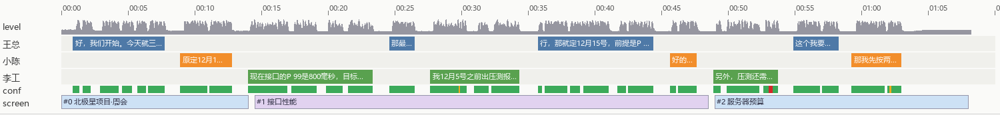
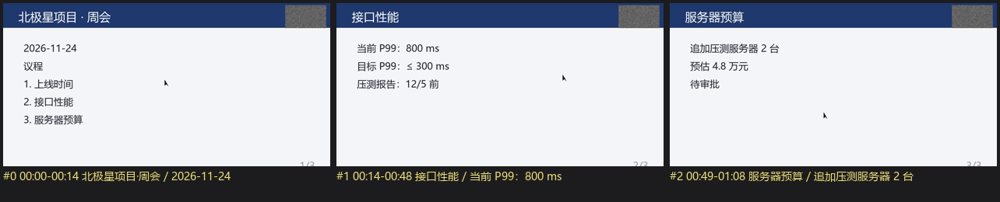
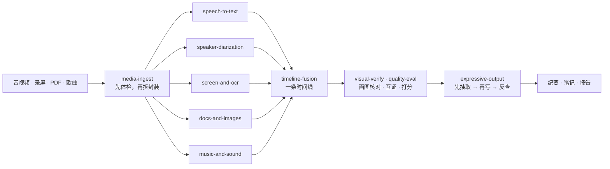

<p align="center">
  
</p>

<p align="center">
  <a href="#安装"></a>
  <a href="#12-个-skill"></a>
  
  
  
  <a href="examples/demo-meeting"></a>
  <a href="LICENSE"></a>
  
</p>

<p align="center">
  <b>用 LLM + 代码，解决所有模态的所有问题。</b><br>
  代码负责把声音、画面、文档变成带时间戳和置信度的文字，LLM 负责理解、核对和表达。<br>
  <b>更好的输入，才有更好的输出。</b>
</p>

---

## 为什么要做这个

把一小时的会议录像直接交给多模态模型，它会给你一份读起来很顺的总结。麻烦在于你不知道哪里是错的。

做这个仓库时，我们只用了一段 68 秒的合成会议做测试，就踩到了下面这些坑：

| 现象 | 原因 | 这里怎么处理 |
|---|---|---|
| 「等**王**总确认」被识别成「等**网**总确认」 | 同音字 | 用屏幕上的文字和参会名单列出候选，让声学模型逐个打分裁决（-0.15 对 -0.58） |
| 加了热词以后，整段转写一个标点都没有 | 空格分隔的热词成了后续每个窗口唯一的提示词，模型照着它的格式输出 | 把热词包装成一句带标点的话 |
| 「那最晚什么时候能好？**我**」：「我」被算到了上一个人头上 | Whisper 把停顿后的第一个词往前拉进了静音里 | 以下一个词的起点为准，重新定位这个词 |
| 两个人的话出现在同一个片段里 | 两人之间的停顿比 VAD 阈值短 | 按句、按词分配说话人，不按片段 |
| 30 px 高的字幕，放大 2 倍后反而识别不出来 | 超出了文字检测模型擅长的尺度 | 先按原尺寸识别，结果弱了才放大，取更好的那次 |
| faster-whisper 读音频直接报错 | PyAV 19 改了接口 | 所有脚本统一用 ffmpeg 管道解码 |

这里面任何一个错误进了纪要，都比漏掉十个虚词严重。所以这套 skill 的重点不是换一个更强的模型，而是三件事：**把输入整理干净，把不确定的地方标出来，让不同模态互相核对**。

## 看效果

[`examples/demo-meeting`](examples/demo-meeting) 是一场完全合成的会议：3 个 Windows TTS 声音扮演 3 个虚构人物，画面里有 3 页幻灯片、一个到处移动的鼠标指针、一个不停闪动的摄像头小窗，底部有硬字幕，结尾还留了 4 秒静音。

**一条命令得到的时间线图**（说话人、逐词置信度、屏幕页）：

<p align="center"></p>

**自动检测并截取的幻灯片**（鼠标指针和摄像头小窗都被正确忽略）：

<p align="center"></p>

**交给 LLM 的输入**（[`timeline.md`](examples/demo-meeting/output/timeline.md) 节选），`{…?}` 是低置信度的词：

```markdown
## [00:49–01:08] 第3页 · 服务器预算
> 屏幕文字：服务器预算 / 追加压测服务器 2 台 / 预估4.8万元 / 待审批

- [00:48] 李工：另外，压测还需要再加两台服务器，大概{4?}万8。
- [00:54] 王总：这个我要再看一下预算，下周一给答复。
- [00:59] 小陈：那我先按两台准备采购单，等王总确认。
```

**最终纪要**（[`minutes.md`](examples/demo-meeting/minutes.md) 节选）：

> **一句话**：上线从 12 月 1 日推迟到 12 月 15 日，前提是接口 P99 降到 300 ms 以下；追加 2 台压测服务器（约 4.8 万）等王总下周一拍板。
>
> | 谁 | 做什么 | 截止 | 原话 |
> |---|---|---|---|
> | 李工 | 出压测报告 | 12 月 5 日前 | `[00:27]` |
> | 小陈 | 发邮件通知客户：上线改到 12 月 15 日 | 本周五前 | `[00:35]` `[00:45]` |

**每个环节都有数字**（合成数据，只证明流程跑通，不代表真实场景的性能）：

| 环节 | 结果 |
|---|---|
| 语音识别（large-v3-turbo，CPU int8，带热词） | CER **0.92%**，关键词召回 94% |
| 翻页检测 | **3/3**，无误报 |
| 硬字幕提取 | **10/10** 句切分正确 |
| 纪要事实覆盖（`coverage_check.py`） | **8/8**；对照组"展开了深入讨论……达成共识"：0/8 |
| 说话人分离（零下载基线 `diarize_lite`） | DER 35.5%，这是弱基线，真实会议请换 pyannote 或 3D-Speaker |

## 它怎么工作



1. **拆**：任何文件先 probe。多音轨、可变帧率、非零起始时间、旋转、内嵌字幕，都在第一步发现。
2. **感知**：每种模态用最合适的工具转成**文本 + 时间戳 + 置信度**。
3. **对齐**：所有东西放到同一个时钟上，按幻灯片分节，生成一份 LLM 能从头读到尾的时间线。
4. **核对**：画成图看；PPT 上的字用来纠正语音里的错字；两个 ASR 引擎结果不同的地方才需要人去听；拿不准的词让声学模型打分。
5. **表达**：先确定读者，按"什么变了"挑重点，结论先行、分层展开；写完逐条对照抽取出来的事实清单反查。

## 12 个 skill

| Skill | 解决什么 | 主要脚本 |
|---|---|---|
| [`solve-everything`](skills/solve-everything) | 总入口：方法论、路线选择、共享数据格式 | — |
| [`media-ingest`](skills/media-ingest) | 先体检再拆封装：音轨、帧、单帧、字幕轨 | `probe.py` `extract.py` |
| [`speech-to-text`](skills/speech-to-text) | 可信的转写：防幻觉、防复读、热词、简体、第二意见、候选打分 | `transcribe.py` `sensevoice_onnx.py` `score_candidates.py` |
| [`speaker-diarization`](skills/speaker-diarization) | 谁在什么时候说话：词级合并、边界修正、有依据地命名 | `diarize_lite.py` `merge_speakers.py` |
| [`screen-and-ocr`](skills/screen-and-ocr) | 屏幕上的字：翻页检测、阅读顺序 OCR、硬字幕转 SRT | `slide_changes.py` `ocr.py` `burned_subs.py` |
| [`docs-and-images`](skills/docs-and-images) | PDF 结构化、扫描页识别、表格、长图切块 | `pdf_extract.py` `tile_image.py` |
| [`music-and-sound`](skills/music-and-sound) | 节拍、人声乐句、歌词对轴 | `beats.py` `vocal_map.py` |
| [`timeline-fusion`](skills/timeline-fusion) | 多模态合成一条时间线（JSONL + Markdown） | `fuse.py` |
| [`visual-verify`](skills/visual-verify) | 画成图核对：时间线图、联系表 | `timeline_plot.py` `contact_sheet.py` |
| [`expressive-output`](skills/expressive-output) | 有表现力又不丢重点的输出：读者、选材、结构、文风、反查 | `coverage_check.py` |
| [`meeting-minutes`](skills/meeting-minutes) | 一条命令从录像到可核对的纪要 | `run_pipeline.py` |
| [`quality-eval`](skills/quality-eval) | CER、DER、事实覆盖、查找时间、消融设计、数据集 | `cer.py` `der.py` |

每个 skill 都可以单独使用，脚本本身也是普通的命令行程序，不依赖任何 agent。

## 安装

**Claude Code（推荐）**

```bash
/plugin marketplace add handsomeZR-netizen/solve-everything
/plugin install solve-everything@solve-everything
```

或者在终端里：`claude plugin marketplace add handsomeZR-netizen/solve-everything`。

**手动**：把 `skills/` 下的文件夹复制到 `~/.claude/skills/`（或项目的 `.claude/skills/`）。`meeting-minutes` 会调用其他 skill 的脚本，所以请把它们放在同一个目录下。支持 `SKILL.md` 格式的其他 agent 也可以这样用。

**依赖**

```bash
pip install -r requirements.txt     # 按需安装，文件里按 skill 分了组
# 另外需要 ffmpeg / ffprobe 在 PATH 上
```

全部默认 CPU 运行。Whisper 模型第一次使用时从 Hugging Face 下载；离线环境可以加 `--local-only`，只用本地缓存。

## 快速开始

直接用自然语言说，相应的 skill 会自动被调用：

- 「把 `meeting.mp4` 整理成会议纪要。参会的有王总、李工、小陈，纪要是给王总看的。」
- 「这个讲座录屏帮我按 PPT 分页做成笔记。」
- 「把这个 MV 里的硬字幕扒成 srt。」
- 「这份扫描版 PDF 里的表格提出来，金额对一下。」
- 「同一段录音用 Whisper 和 SenseVoice 各转一遍，比较 CER。」

也可以直接跑命令：

```bash
python skills/meeting-minutes/scripts/run_pipeline.py meeting.mp4 --work work/ \
    --speakers 3 --hotwords "北极星 P99 压测 王总 李工 小陈" \
    --crop 0,0,1600,900 --mask 1600,0,320,180
# 然后让 Claude 读 work/timeline.md 和 work/plots/ 下的图，按 expressive-output 写纪要
```

## 设计原则

- **先看再做**：probe 的一条 warning 能省一小时返工。
- **每一步都落盘**：中间文件可以检查、可以重跑，也能直接写进论文的方法部分。
- **时间戳是主键**：所有模态都对齐到"距文件开头的秒数"。
- **置信度一路带到底**：低置信度的人名和数字，在终稿里要么核实，要么标"存疑"。
- **互证胜过猜测**：屏幕文字纠正语音，声学模型给候选打分，两个引擎有分歧的地方才需要人听。
- **能画成图就画成图**：模型听不到声音，但看得到图。
- **不编造**：原文没有的负责人和截止时间写"未明确"。

## 已知限制

- `diarize_lite` 是零下载的弱基线（合成演示上 DER 35.5%）。真实会议请用 pyannote、sherpa-onnx（3D-Speaker）或 FunASR cam++，调用方式见 [`backends.md`](skills/speaker-diarization/references/backends.md)。这三段代码依据官方文档整理，**没有在本仓库的测试中运行过**。
- FunASR 的用法说明同样没有实测。
- 演示用的是合成语音，比真实会议（远场、抢话、口音、噪声）容易得多。
- 只在 Windows 11、Python 3.13、纯 CPU 环境下测试过。脚本已兼容 Linux / macOS 的字体路径，但没有在这两个系统上跑过。

## 路线图

- [ ] sherpa-onnx 说话人分离脚本（实测）
- [ ] FunASR 后端脚本（实测）
- [ ] 在 AliMeeting 子集上给出真实会议的基准数字
- [ ] 腾讯会议、飞书、Zoom 聊天记录导入为 `--notes`
- [ ] 英文版 README

## 致谢

[FFmpeg](https://ffmpeg.org) ·
[faster-whisper](https://github.com/SYSTRAN/faster-whisper) / [CTranslate2](https://github.com/OpenNMT/CTranslate2) / [Whisper](https://github.com/openai/whisper) ·
[SenseVoice](https://github.com/FunAudioLLM/SenseVoice) · [sherpa-onnx](https://github.com/k2-fsa/sherpa-onnx) ·
[RapidOCR](https://github.com/RapidAI/RapidOCR) / [PaddleOCR](https://github.com/PaddlePaddle/PaddleOCR) ·
[librosa](https://librosa.org) · [PyMuPDF](https://github.com/pymupdf/PyMuPDF) · [SciPy](https://scipy.org)

## English

**solve-everything** is a Claude Code plugin with 12 skills for multimodal work: code turns audio, video, screen recordings, documents and music into timestamped, confidence-scored text; the LLM aligns, cross-checks, understands and writes. Every script is a plain Python CLI that runs on CPU. The skills include probing media, guarded Whisper transcription, SenseVoice as a second opinion, forced-alignment candidate scoring, speaker diarization merge, slide-change detection, reading-order OCR, burned-in subtitle extraction, PDF structuring, beat and vocal-phrase analysis, timeline fusion, visual verification, fact-checked writing, and CER/DER evaluation. Install with `/plugin marketplace add handsomeZR-netizen/solve-everything`, then `/plugin install solve-everything@solve-everything`. The skill docs are written in Chinese; code, CLI flags and data formats are in English.

## License

[MIT](LICENSE)
