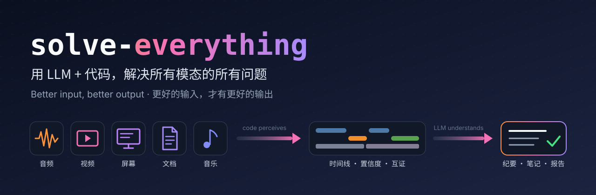
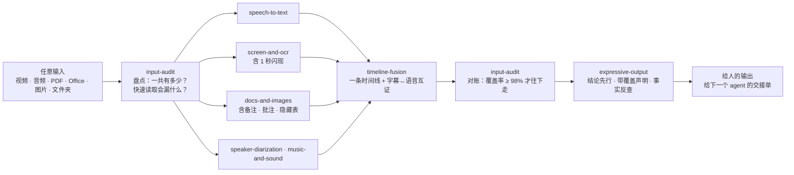
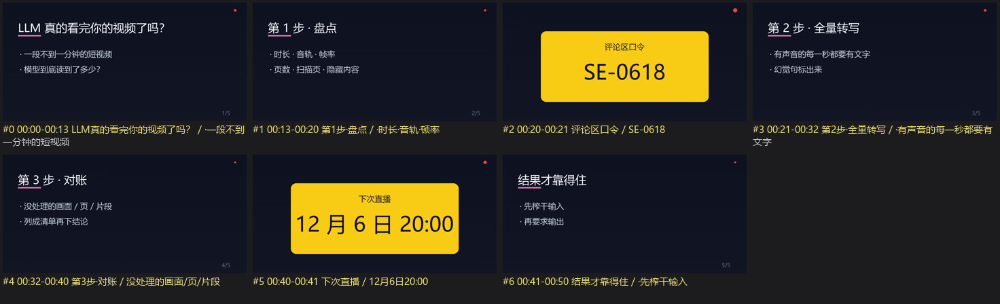
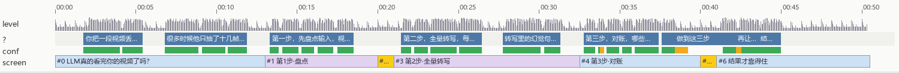

<p align="center">
  
</p>

<p align="center">
  <a href="#安装"></a>
  <a href="#13-个-skill"></a>
  <a href="examples/short-video"></a>
  <a href="examples/short-video/output/coverage.md"></a>
  
  
  <a href="LICENSE"></a>
</p>

<p align="center">
  <a href="https://www.douyin.com/user/MS4wLjABAAAAWr14wPFzV0TPT9stvfK6u0EiHI_R5nrvtDVlTMOXZGDOWOHP8IR-uF2Y7WPRjkcm"></a>
  
  
  
</p>

<p align="center">
  
  
  
  
  
  
</p>

<h2 align="center">LLM 真的处理完你的输入了吗？</h2>

<p align="center">
  你把一段视频、一份 PDF、一个 PPT 交给模型，它给了你一个流畅、自信、看起来很完整的回答。<br>
  可它<b>没告诉你</b>：视频只抽了十几帧，PDF 第 2 页是扫描件，PPT 的演讲备注它压根没打开。<br><br>
  <b>solve-everything</b> 用代码把每一种输入完整地、可核对地转成文字，再用一本账算清楚<b>处理完了没有</b>。<br>
  先榨干输入，再要求输出。
</p>

---

## 先看数字

我们准备了一个文件夹：1 条 50 秒的知识短视频、1 份 PDF、1 张长截图、1 个 PPT、1 个 Word、1 个 Excel。里面藏着 **8 条关键信息**，都放在了常见读取方式看不到的地方。

| | 常见的快速读取 | **solve-everything** |
|---|:---:|:---:|
| 视频里只闪现 1 秒的 2 条信息（口令、直播时间） | 均匀抽 8 帧：**0/2**<br>均匀抽 16 帧：**1/2** | 只截 7 张图：**2/2**<br>画面状态 7/7 |
| PDF 扫描页上的结论和预算上限 | 只读文字层：**看到的是一页白纸**<br>（覆盖率 50%） | OCR 后 **2/2 页** |
| 长截图最后一行的交付时间 | 整图缩到 **0.31 倍**，30 px 的字只剩 9 px | 切 4 块，每块 **1.0 倍** |
| PPT 演讲备注"其实已经决定选 B"、隐藏页"供应商可能延期两周" | 只读幻灯片正文：**0/2** | **2/2** |
| Word 批注"这一条要改，先别发" | 只读正文：**0/1** | **1/1** |
| Excel 隐藏表里的 130（汇总表写的是 100） | 默认只读第一张表：**0/1** | **1/1**，并标为矛盾 |
| **合计** | **最多 1/8** | **8/8，7 个输入覆盖率全部 100%** |

还没完。口播和硬字幕交叉核对后，自动标出 **7 处不一致**：语音识别错了 4 处（「它」听成「他」、「音轨」听成「音柜」），字幕 OCR 错了 3 处，其中一处漏掉了「没」字，把「哪些片段**没**被处理」变成了「哪些片段被处理」，意思完全反了。单看任何一路来源，这些错误都发现不了。

> 全部数据来自 [`examples/short-video`](examples/short-video)，可以复现。数据是合成的，用来证明"漏"真实存在、可以被测量，不代表任何具体产品的行为。

## 作者和设计来源

<table>
<tr>
<td width="58%">

**抖音「每天每天」** · 抖音号 `36529386652`<br>
62 个作品 · **9.2 万粉丝** · **531.2 万获赞**（截至 2026-11）

- 《我不难过》MV 重制版：**916.0 万**播放
- 《眼泪成诗》MV：**486.5 万**播放
- 《天黑黑》MV：**477.2 万**播放

[主页](https://www.douyin.com/user/MS4wLjABAAAAWr14wPFzV0TPT9stvfK6u0EiHI_R5nrvtDVlTMOXZGDOWOHP8IR-uF2Y7WPRjkcm) · [《眼泪成诗》MV](https://www.douyin.com/video/7697609227690446131)

</td>
<td>

这个仓库有两个来源：

**① 一个 9.2 万粉丝账号的实操。** 每做一条音乐 MV，都要把一首歌、一段歌词视频、几张参考图榨干：歌词哪一秒出现（硬字幕 OCR 对轴）、人声乐句在哪（人声地图）、鼓点落在哪（节拍）、每一帧对不对（联系表）。仓库里最早的那批脚本就是从这些工作流里抽出来的。

**② 前沿大模型 agent 的工作方式。** 把感知交给工具，每一步都落盘、可核对，把不确定性写出来，用验证代替自信。整个仓库就是用 Claude Code 在真实任务中一轮一轮迭代出来的。

</td>
</tr>
</table>

## 输入是怎么被悄悄丢掉的

| 输入 | 常见的丢法 |
|---|---|
| 视频 | 只抽固定数量的帧；一闪而过的卡片、价格、口令、某一页 PPT 根本没被采到 |
| 音频 | 只听第一条音轨；轻声、唱歌被 VAD 当成静音；静音段冒出"字幕由 Amara.org 社区提供"这种幻觉句 |
| 图片 | 长边超过视觉上限后被缩小（Claude 约 1568 px）；长截图的小字糊成一片 |
| PDF | 扫描页没有文字层；图表里的数字不在文字层；多栏排版顺序错乱 |
| Office | 演讲备注、隐藏页、批注、修订、隐藏工作表、页眉页脚、嵌入图片 |
| 文本 | 超出上下文被截断；长文"中间丢失" |
| 上游 agent | 交过来的是摘要；摘要漏了什么，下游无从得知 |

模型几乎从不说"我没看第 37 页"。所以这件事不能靠模型自觉，要靠**盘点 → 处理 → 对账**。

## 它怎么工作



| 步骤 | 做什么 |
|---|---|
| 0 盘点 | 列出每个输入的总量：秒、帧、页、扫描页、幻灯片、备注、隐藏表、像素……以及快速读取会丢掉什么 |
| 1 拆 | 抽音轨和帧、分页、解包 Office、把大图切块 |
| 2 感知 | 每种模态都转成"文字 + 时间戳/页码 + 置信度" |
| 3 互证 | 合成一条时间线；字幕对语音、画面对口播、汇总表对原始表 |
| 4 对账 | 用中间文件对照盘点账算覆盖率；不达标就不下结论 |
| 5 表达 | 先定读者，按"什么变了、什么藏着、什么对不上"选重点；结论先行；每条都有出处；写完反查 |

## 看效果

**画面变化检测**：7 张截图拿到全部 7 个状态，包括两张只停留 1 秒的黄色闪现卡片（均匀抽 16 帧会漏掉一张）。

<p align="center"></p>

**时间线图**：语音、置信度、画面状态（黄色为闪现）。

<p align="center"></p>

**交给 LLM 的时间线**（[`timeline.md`](examples/short-video/output/timeline.md) 节选）：

```markdown
## [00:13–00:20] 第2页 · 第1步·盘点
- [00:13] 第一步，先盘点输入，视频多长，有几条音柜，PDF有几页。
- [00:13] 〔字幕〕第一步，先盘点输入：视频多长，有几条音轨，PDF有几页。
  - ⚠ 字幕/语音不一致（字幕在前，语音在后）：「轨」/「柜」
- [00:20] **〔屏幕闪现 1.0s〕评论区口令 / SE-0618** (flash_002.png)
```

**交给下一个 agent 的交接单**（[`handoff.md`](examples/short-video/handoff.md) 节选，12/12 条事实反查通过）：

> **一句话**：6 个文件全部处理完，覆盖率 100%。其中 8 条关键信息藏在快速读取看不到的地方，有 2 处内容互相矛盾，需要人来确认。
>
> 1. **同一个数据两个数**：`data.xlsx` 的汇总表写 A = 100，隐藏的「原始数据」表写 A = 130。
> 2. **正文和批注冲突**：`notes.docx` 正文写「按原计划推进」，批注写「这一条要改，先别发」。

**对账**（[`coverage.md`](examples/short-video/output/coverage.md)）：

| input | kind | coverage | verdict |
|---|---|---|---|
| `clip.mp4` | audio | 100.0% | OK |
| `clip.mp4` | video | 100.0% | OK |
| `report.pdf` | pdf | 100.0% | OK |
| `long_screenshot.png` | image | 100.0% | OK |
| `deck.pptx` / `notes.docx` / `data.xlsx` | office | 100.0% | OK |

同一批输入用快速读取的方式，PDF 只有 **50%**、长截图只有 **31%**，[`coverage_quick_read.md`](examples/short-video/output/coverage_quick_read.md) 判定为 **FAIL**。

## 13 个 skill

| Skill | 解决什么 | 主要脚本 |
|---|---|---|
| [`solve-everything`](skills/solve-everything) | 总入口：方法、选路线、共享数据格式 | — |
| [`input-audit`](skills/input-audit) | **LLM 真的处理完了吗**：盘点总量、计算覆盖、列出缺口、多 agent 交接协议 | `inventory.py` `coverage.py` |
| [`media-pipeline`](skills/media-pipeline) | 任意音视频一条命令：盘点 → 转写 → 画面 → 字幕 → 节拍 → 时间线 → 对账 | `run_pipeline.py` |
| [`media-ingest`](skills/media-ingest) | 先体检再拆封装：音轨、帧、单帧、内嵌字幕 | `probe.py` `extract.py` |
| [`speech-to-text`](skills/speech-to-text) | 可信的转写：防幻觉、防复读、按句切分、热词、第二意见、候选打分 | `transcribe.py` `sensevoice_onnx.py` `score_candidates.py` |
| [`speaker-diarization`](skills/speaker-diarization) | 谁在什么时候说话：词级合并、边界修正、有依据地命名 | `diarize_lite.py` `merge_speakers.py` |
| [`screen-and-ocr`](skills/screen-and-ocr) | 画面的每个状态，包括 1 秒闪现；阅读顺序 OCR；硬字幕转 SRT | `slide_changes.py` `ocr.py` `burned_subs.py` |
| [`docs-and-images`](skills/docs-and-images) | PDF、扫描页、Office 全量解包（备注、批注、隐藏表）、长图切块 | `pdf_extract.py` `office_extract.py` `tile_image.py` |
| [`music-and-sound`](skills/music-and-sound) | 节拍、人声乐句、歌词对轴 | `beats.py` `vocal_map.py` |
| [`timeline-fusion`](skills/timeline-fusion) | 多模态合成一条时间线，字幕↔语音自动互证 | `fuse.py` |
| [`visual-verify`](skills/visual-verify) | 画成图核对：时间线图、联系表 | `timeline_plot.py` `contact_sheet.py` |
| [`expressive-output`](skills/expressive-output) | 有表现力又不丢重点：读者、选材、结构、文风、覆盖声明、事实反查、交接单 | `coverage_check.py` |
| [`quality-eval`](skills/quality-eval) | 覆盖率、CER、DER、事实覆盖、消融设计、公开基准 | `cer.py` `der.py` |

## 给所有 agent 协作者

- **Claude Code**：作为插件安装，skill 会按描述自动触发。
- **其他支持 `SKILL.md` 的 agent**：把 `skills/` 复制到它的 skills 目录。
- **任何 agent，或者人**：仓库根目录的 [`AGENTS.md`](AGENTS.md) 是一页纸的协作协议；所有脚本都是普通的命令行程序，不依赖任何 agent 框架。

协议的核心只有三条：

1. **处理前先盘点**：一共有多少？快速读取会漏什么？
2. **交出结果时附带覆盖声明**：处理了什么、没处理什么、哪些存疑。
3. **收到没有覆盖声明的结果，一律按"未验证"处理**，关键结论回到原文核对。

## 安装

**Claude Code**

```bash
/plugin marketplace add handsomeZR-netizen/solve-everything
/plugin install solve-everything@solve-everything
```

**手动**：把 `skills/` 下的文件夹复制到 `~/.claude/skills/`（或项目的 `.claude/skills/`）。`media-pipeline` 会调用其他 skill 的脚本，请把它们放在同一个目录下。

**依赖**

```bash
pip install -r requirements.txt     # 按需安装，文件里按 skill 分了组
# 另外需要 ffmpeg / ffprobe 在 PATH 上
```

默认全部在 CPU 上运行。Whisper 模型第一次使用时会从 Hugging Face 下载；离线环境加 `--local-only`，只用本地缓存。

## 快速开始

直接用自然语言说：

- 「这个文件夹里的东西帮我全部过一遍，告诉我有没有藏着的信息和对不上的地方。」
- 「拆解一下这条短视频：结构、钩子、画面上闪过的字、节奏。」
- 「这个讲座录屏按 PPT 分页做成笔记，PPT 上没有、老师口头补充的内容要单独标出来。」
- 「把这个 PPT 和 Excel 的内容总结给我，备注和隐藏表也算。」
- 「上一个 agent 给的总结可信吗？对照原文帮我对账。」

或者直接跑命令：

```bash
python skills/input-audit/scripts/inventory.py inputs/ --out ledger.json --md ledger.md
python skills/media-pipeline/scripts/run_pipeline.py inputs/clip.mp4 --work work/ --crop 0,0,1280,620 --subs-crop 0,620,1280,100 --music
python skills/docs-and-images/scripts/office_extract.py inputs/*.pptx inputs/*.docx inputs/*.xlsx --out-dir work/office
python skills/input-audit/scripts/coverage.py summary --cov work/coverage.json --md work/coverage.md
```

## 已知限制

- 示例数据是合成的（Windows TTS 配音、程序生成的画面和文档），比真实场景简单。它证明"漏"真实存在、可以被测量，不代表任何产品的真实表现。
- 抽帧对比是一个模型：它描述"均匀抽 N 帧"这类策略的后果，不声称任何具体产品就是这么做的。
- `diarize_lite` 是零下载的弱基线（开发时在合成三人对话上 DER 约 36%）。真实的多人录音请用 pyannote、sherpa-onnx 或 FunASR，调用方式见 [`backends.md`](skills/speaker-diarization/references/backends.md)，这几段代码没有在本仓库实测过。
- 只在 Windows 11、Python 3.13、纯 CPU 环境下测试过。

## 路线图

- [ ] 真实视频上的抽帧漏检基准（短视频、课程、直播回放各一组）
- [ ] 评论区、弹幕导入为时间线 `--notes`
- [ ] sherpa-onnx 说话人分离脚本（实测）
- [ ] 英文版 README

## 致谢与商标说明

[FFmpeg](https://ffmpeg.org) · [faster-whisper](https://github.com/SYSTRAN/faster-whisper) / [CTranslate2](https://github.com/OpenNMT/CTranslate2) / [Whisper](https://github.com/openai/whisper) · [SenseVoice](https://github.com/FunAudioLLM/SenseVoice) · [sherpa-onnx](https://github.com/k2-fsa/sherpa-onnx) · [RapidOCR](https://github.com/RapidAI/RapidOCR) / [PaddleOCR](https://github.com/PaddlePaddle/PaddleOCR) · [librosa](https://librosa.org) · [PyMuPDF](https://github.com/pymupdf/PyMuPDF) · [SciPy](https://scipy.org)

文中出现的产品名称和标志归各自所有者所有，仅用于说明本项目使用或兼容的工具。本项目与这些公司和项目没有隶属或背书关系。抖音数据截至 2026 年 11 月，来自作者本人的账号主页。

## English

**Did the LLM really process all of your input?** Models rarely say "I skipped page 37". solve-everything is a Claude Code plugin with 13 skills that inventory every input first, turn audio, video, screens, PDFs, Office files and music into timestamped, confidence-scored text with code (including one-second flash cards, scanned pages, speaker notes, comments and hidden sheets), cross-check the modalities, prove coverage, and only then let the model write, with a coverage statement any agent can trust. On the bundled synthetic test folder, common quick reads recover at most 1 of 8 hidden facts; the full pipeline recovers 8 of 8 with 100% coverage on all 7 inputs. Install with `/plugin marketplace add handsomeZR-netizen/solve-everything`, then `/plugin install solve-everything@solve-everything`. Skill docs are in Chinese; code, CLI flags and data formats are in English.

## License

[MIT](LICENSE)
